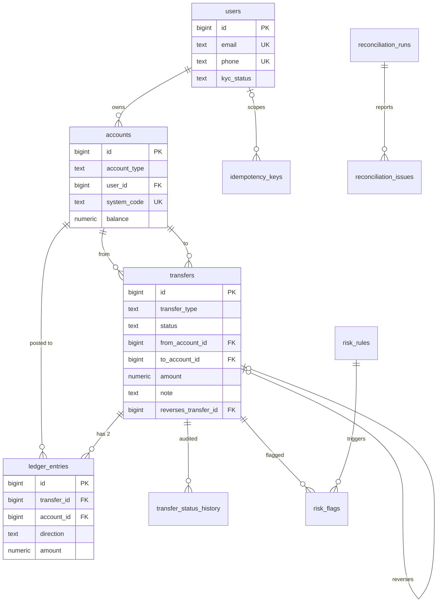

# Schema

## Nouns

| Noun | Table | Purpose |
|---|---|---|
| User | `users` | A person. Unique email (case-insensitive) and phone. `kyc_status` is stored, not enforced. |
| Account | `accounts` | Anything that holds a balance: a user wallet or a system account (`CASH_IN`, `CASH_OUT`, `FEE_REVENUE`). |
| Transfer | `transfers` | One business operation moving money between two accounts. |
| Ledger entry | `ledger_entries` | One side (`DEBIT` or `CREDIT`) of a transfer. Append-only. |
| Status history | `transfer_status_history` | Audit trail of every transfer status change and who made it. |
| Idempotency key | `idempotency_keys` | Saved response for a client-supplied `Idempotency-Key`. |
| Job lock | `job_locks` | One row per background job, locked with `FOR UPDATE NOWAIT`. |
| Reconciliation run / issue | `reconciliation_runs`, `reconciliation_issues` | Nightly consistency check results. |
| Risk rule / flag | `risk_rules`, `risk_flags` | Fraud thresholds and the rule hits recorded against transfers. |

## Cardinality decisions

- **User to account: 1 to many.** A user can have several wallets (the seeder creates two each). System accounts have no user.
- **One `accounts` table, not two.** Wallets and system accounts both take part in double-entry. A single table lets the ledger reference any account with one foreign key. `CHECK` constraints keep the two kinds apart: a wallet requires `user_id` and forbids `system_code`, and a system account is the reverse.
- **Transfer to ledger entries: 1 to 2.** Each transfer has one debit and one credit of the same amount. A deferred constraint trigger checks this at commit. `HELD` and `REJECTED` transfers have no entries.
- **Transfer to reversal: 1 to 0..1.** `reverses_transfer_id` has a partial unique index, so a transfer can be reversed only once. Reversals are full only.
- **Transfer to status history: 1 to many.** A trigger writes a row on insert and on each status change. The actor comes from `set_config('app.actor', ..., true)` and defaults to `system`.
- **Transfer to risk flags: 1 to many.** Several rules can fire on one transfer.
- **Idempotency key scope: user, or anonymous.** `user_id` is nullable so `POST /users` can use keys. The unique index is on `(COALESCE(user_id, 0), key)`.

## Money rules

- Debit is money out, credit is money in. Entries store a positive `amount` plus a `direction`.
- Balance equals credits minus debits. `accounts.balance` stores it and the nightly check recomputes it.
- `NUMERIC(19,2)` for all amounts. Currency is `INR` only.
- `CHECK (account_type <> 'USER_WALLET' OR balance >= 0)` stops wallet overdrafts. System accounts may go negative: `CASH_IN` goes negative as top-ups are issued.

## Immutability

- `ledger_entries` and `transfer_status_history` reject `UPDATE`, `DELETE` and `TRUNCATE` through triggers (`forbid_mutation`).
- Reconciliation tests bypass this with `SET session_replication_role = replica`, which needs superuser. The application role must not have that right.

## Indexes

| Index | Serves |
|---|---|
| `ledger_entries (account_id, created_at DESC, id DESC)` | Statement pages and balance recomputation per account |
| `ledger_entries (transfer_id)` | Per-transfer balance check, orphan check, the commit-time balance trigger |
| `transfers (from_account_id, created_at)` | Velocity rule and amount-spike history |
| `transfers (from_account_id, to_account_id) WHERE status = 'COMPLETED'` | New-payee rule |
| `transfers (reverses_transfer_id) WHERE NOT NULL`, unique | One reversal per transfer |
| `transfers (created_at) WHERE status = 'HELD'` | Risk review queue |
| `users (lower(email))`, `users (phone)`, unique | Duplicate prevention |
| `accounts (system_code) WHERE NOT NULL`, unique | System account lookup |
| `idempotency_keys (COALESCE(user_id,0), key)`, unique | Key claim, `ON CONFLICT DO NOTHING` |
| `idempotency_keys (created_at)` | 24-hour purge |

## ER diagram

